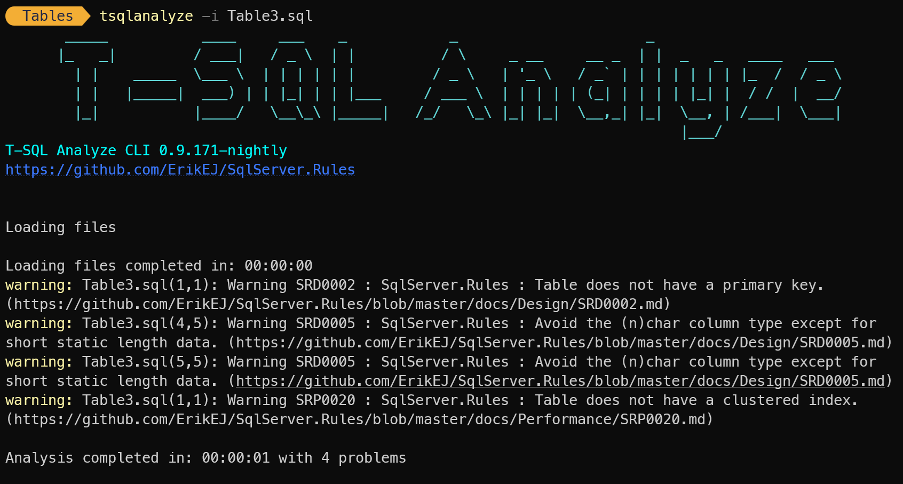

# T-SQL Analyzer CLI

T-SQL Analyzer is a command line tool for identifying, and reporting the presence of anti-patterns in T-SQL scripts.

It evaluates more than [140 rules](https://github.com/ErikEJ/SqlServer.Rules/blob/master/docs/readme.md) for design, naming and performance issues.

## Getting started

The tool runs on any system with the .NET 10.0 SDK (or later) installed.

### Installing the tool

```bash
dotnet tool install --global ErikEJ.DacFX.TSQLAnalyzer.Cli
```

### Usage

```bash
# Analyze all .sql scripts in current folder and sub-folders
tsqlanalyze

## Analyze a single file
tsqlanalyze -i C:\scripts\sproc.sql

## Analyze a folder
tsqlanalyze -i "c:\database scripts"

## Analyze a folder with a filter and a full folder path
tsqlanalyze -i c:\database_scripts\sp_*.sql "c:\old scripts"

## Analyze a script with a rule settings filter and for a specific SQL Server version
tsqlanalyze -i C:\scripts\sproc.sql -r Rules:-SqlServer.Rules.SRD0004 -s SqlAzure

## Analyze a .dacpac and save results to an xml file
tsqlanalyze -i C:\scripts\Chinook.dacpac -o result.xml

## Analyze a .dacpac and save results to a JSON file
tsqlanalyze -i C:\scripts\Chinook.dacpac -o result.json

## Analyze a folder and save results to a SARIF file
tsqlanalyze -i C:\scripts -o result.sarif

## Accept the current problems in a baseline, then report only new problems
tsqlanalyze -i C:\scripts --baseline baseline.json --update-baseline
tsqlanalyze -i C:\scripts --baseline baseline.json

## Analyze a .zip file with .sql files
tsqlanalyze -i C:\scripts\Fabric.zip

## Analyze a live database
tsqlanalyze -c "Data Source=.\SQLEXPRESS;Initial Catalog=Chinook;Integrated Security=True;Encrypt=false"

## Analyze a single file, and include path(s) to your own rules .dll file(s)
tsqlanalyze -i C:\scripts\sproc.sql -a C:\code\analyzers

## Analyze a single file, and reformat (PREVIEW)
tsqlanalyze -i C:\scripts\sproc.sql -f 
```

Rule settings filters are demonstrated [here](https://github.com/rr-wfm/MSBuild.Sdk.SqlProj?tab=readme-ov-file#static-code-analysis)

The SQL Server version values are documented [here](https://learn.microsoft.com/dotnet/api/microsoft.sqlserver.dac.model.sqlserverversion)

> Note: UTF-8 with BOM encoding is required for the input files.

## Rule configuration

By default, rules discover `.editorconfig` settings from each SQL source file. To apply one configuration to all objects, including DACPACs, databases, ZIPs, or text input, use:

```bash
tsqlanalyze -i C:\scripts\database.dacpac --editorconfig C:\config\.editorconfig
```

Only `[*.sql]` sections in the selected file are used; source-file configuration is not merged. Relative policy and exceptions paths are resolved from that file's directory. The same override is available as `editorConfigPath` in server-mode requests.

For SRD0097 policy and exceptions settings, see the [rule documentation](https://github.com/ErikEJ/SqlServer.Rules/blob/master/docs/Design/SRD0097.md).

## SARIF output

Use an output file with the `.sarif` extension to write the problems as [SARIF 2.1.0](https://sarifweb.azurewebsites.net/), the format read by GitHub code scanning and Azure DevOps.

```bash
tsqlanalyze -i src/Database -o tsqlanalyzer.sarif
```

- Files below the current directory are written as relative paths, so run the tool from the repository root. Other files are written as absolute `file://` URIs.

To show the problems on pull requests in GitHub:

```yaml
permissions:
  security-events: write

steps:
  - uses: actions/checkout@v7
  - uses: actions/setup-dotnet@v6
    with:
      dotnet-version: 10.0.x
  - run: dotnet tool install --global ErikEJ.DacFX.TSQLAnalyzer.Cli
  - run: tsqlanalyze -n -i src/Database -o tsqlanalyzer.sarif
  - uses: github/codeql-action/upload-sarif@v4
    if: always()
    with:
      sarif_file: tsqlanalyzer.sarif
```

## Baseline

A baseline suppresses problems up to the accepted count for each source and rule. If the current count exceeds that count, all current problems for that source and rule are reported because counts cannot identify which ones are new.

```bash
# Accept the problems found now. Commit baseline.json to source control.
tsqlanalyze -i src/Database --baseline baseline.json --update-baseline

# Report only problems that the baseline does not cover
tsqlanalyze -i src/Database --baseline baseline.json
```

The baseline holds the number of accepted problems per rule for each source file, with file paths relative to the baseline file:

```json
{
  "version": 1,
  "problems": {
    "Procedures/GetOrders.sql": {
      "SqlServer.Rules.SRD0006": 2,
      "SqlServer.Rules.SRP0005": 1
    }
  }
}
```

## Sample output

The tool will output a summary of the rules that were violated, and the line numbers where the violations occurred.

Table3.sql:

```sql
CREATE TABLE [dbo].[Table3]
(
    [Id] INT NOT NULL, 
    [Wang] NCHAR(500) NOT NULL, 
    [Chung] NCHAR(10) NOT NULL 
)
```



## MCP Server

You can use the tool to ask GitHub Copilot to analyze your SQL Server T-SQL scripts in Visual Studio, SSMS or VS Code.

The TSQL Analyzer MCP Server supports quick installation across multiple development environments. Choose your preferred client below for streamlined setup:

| Client | One-click Installation | MCP Guide |
|--------|----------------------|-------------------|
| **VS Code** | [](https://vscode.dev/redirect/mcp/install?name=tsqlanalyzer&config=%7B%22name%22%3A%22tsqlanalyzer%22%2C%22command%22%3A%22dnx%22%2C%22args%22%3A%5B%22ErikEJ.DacFX.TSQLAnalyzer.Cli%22%2C%22--yes%22%2C%22--%22%2C%22-mcp%22%5D%7D) | [VS Code MCP Official Guide](https://code.visualstudio.com/docs/copilot/chat/mcp-servers) |
| **Visual Studio** | [](https://vs-open.link/mcp-install?%7B%22name%22%3A%22tsqlanalyzer%22%2C%22type%22%3A%22stdio%22%2C%22command%22%3A%22dnx%22%2C%22args%22%3A%5B%22ErikEJ.DacFX.TSQLAnalyzer.Cli%22%2C%22--yes%22%2C%22--%22%2C%22-mcp%22%5D%7D) | [Visual Studio MCP Official Guide](https://learn.microsoft.com/visualstudio/ide/mcp-servers) |

**Example JSON configuration:**

```json
{
    "servers": {
        "tsqlanalyzer": {
            "type": "stdio",
            "command": "dnx",
            "args": [
                "ErikEJ.DacFX.TSQLAnalyzer.Cli",
                "--yes",
                "--",
                "-mcp"
            ]
        }
    }
}
```

## SQL Formatting (preview)

Inspired by the [SQL Formatter](https://marketplace.visualstudio.com/items?itemName=MadsKristensen.SqlFormatter) Visual Studio extension from [Mads Kristensen](https://github.com/madskristensen), the `-f` switch will enable formatting of the analyzed scripts using the [ScriptDom library](https://www.nuget.org/packages/Microsoft.SqlServer.TransactSql.ScriptDom).

- Formats T-SQL code to a consistent and readable layout
- Customizable formatting rules
- `.editorconfig` support

See [this](https://github.com/madskristensen/SqlFormatter?tab=readme-ov-file#editorconfig-support) for information about the `.editorconfig` format.

See [this](https://learn.microsoft.com/dotnet/api/microsoft.sqlserver.transactsql.scriptdom.sqlscriptgeneratoroptions?view=sql-transactsql-161#properties) for information about the available options.

> Enabling this will cause your script files to be updated!

mcp-name: io.github.ErikEJ/SqlServer.Rules
